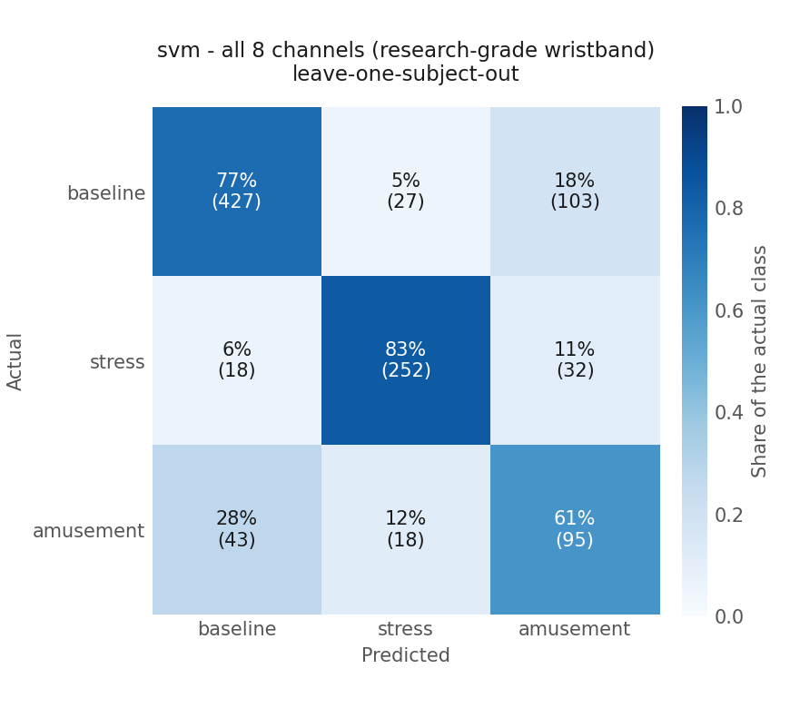
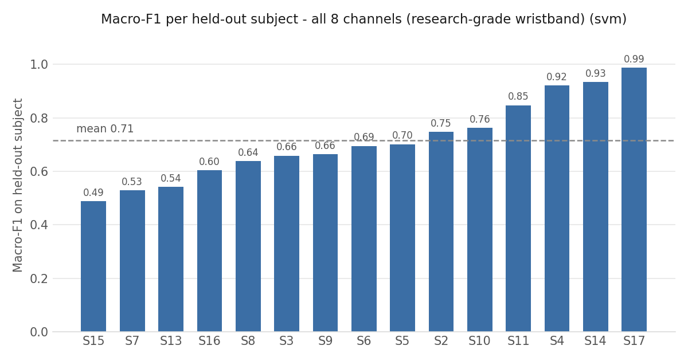
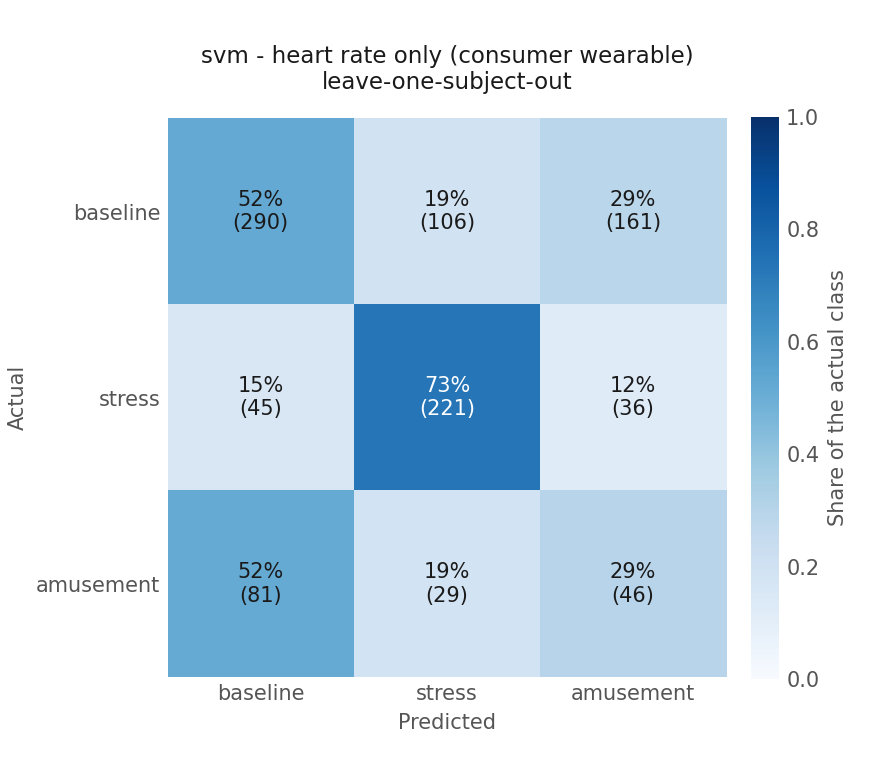
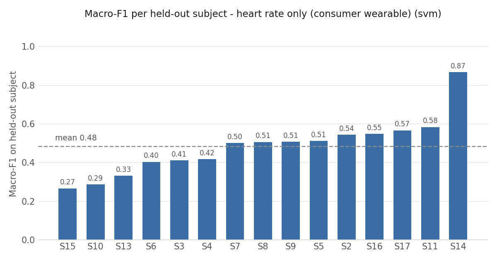

# WESAD wrist-based stress classification - results

Generated by `scripts/04_evaluate.py`. Every number here comes from leave-one-subject-out cross-validation on the WESAD dataset.

## Data

| | |
|---|---|
| Dataset | WESAD, wrist (Empatica E4) signals only |
| Signals available | EDA, TEMP, BVP, ACC (x/y/z + magnitude), HR derived from BVP |
| Subjects | 15 (S2-S17; S1 and S12 are not part of the dataset) |
| Classes | baseline / stress / amusement (the 3-class WESAD benchmark) |
| Window length | 60 s |
| Window step | 30 s (50% overlap) |
| Label purity required | 100% - windows spanning a condition change are dropped |
| Windows kept | 1015 |

### Class balance

| Class | Windows | Share |
|---|---|---|
| baseline | 557 | 54.9% |
| stress | 302 | 29.8% |
| amusement | 156 | 15.4% |

The classes are imbalanced because the baseline condition simply lasted longer in the study protocol. That is why the headline metric is macro-F1 rather than accuracy: macro-F1 weights all three classes equally, so a model that ignores the smallest class cannot hide behind a high accuracy.

### Windows per subject

| Subject | Windows |
|---|---|
| S10 | 69 |
| S11 | 70 |
| S13 | 69 |
| S14 | 69 |
| S15 | 69 |
| S16 | 67 |
| S17 | 69 |
| S2 | 65 |
| S3 | 67 |
| S4 | 66 |
| S5 | 67 |
| S6 | 67 |
| S7 | 67 |
| S8 | 68 |
| S9 | 66 |

## Validation method

Leave-one-subject-out cross-validation (15 folds): each fold trains on 14 subjects and tests on the one subject held out.

A random row-wise split would be wrong here. Windows from the same person share their skin conductance level, their resting heart rate and their sensor fit, and with 50% overlap two neighbouring windows literally share 30 seconds of signal. Split randomly, the model could score well by recognising the person rather than the stress state - leakage that inflates the reported accuracy. Splitting by subject measures the thing we actually care about: does this generalise to a new person?

## Two feature sets: research-grade vs. consumer wearable

The same windows, the same folds and the same model settings were used twice, changing only which columns the model is given:

| Feature set | Features | What it represents |
|---|---|---|
| `full` | 40 | An Empatica E4 research wristband: electrodermal activity, skin temperature, raw PPG and raw 3-axis accelerometry, plus heart rate |
| `hr_only` | 5 | A mainstream consumer wearable (Fitbit-class): heart rate and nothing else. `HR_mean, HR_std, HR_min, HR_max, HR_slope` |

Nothing was tuned separately for the two sets - same algorithm, same hyperparameters, same cross-validation. Any difference in score is therefore caused by the missing sensors, not by the modelling.

### Headline comparison (SVM, leave-one-subject-out)

| Feature set | Accuracy | Macro-F1 |
|---|---|---|
| `full` - all 8 channels | 0.763 | **0.717** |
| `hr_only` - heart rate only | 0.549 | **0.499** |
| **Change** | -0.214 | **-0.217 (-30.3%)** |

**Restricting the model to what a wrist-heart-rate-only consumer wearable can provide costs 0.217 macro-F1, a 30.3% relative drop** (0.717 -> 0.499).

For reference, always predicting the largest class (baseline) would give an accuracy of 0.549 and a macro-F1 of 0.236, so the heart-rate-only model is well above chance - it is degraded, not useless.

Both algorithms were run on both feature sets; the full grid is below, so the choice of SVM for the headline can be checked rather than taken on trust.

| Feature set | Model | Accuracy | Macro-F1 |
|---|---|---|---|
| `full` | random forest | 0.771 | 0.631 |
| `full` | svm | 0.763 | 0.717 |
| `hr_only` | random forest | 0.630 | 0.498 |
| `hr_only` | svm | 0.549 | 0.499 |

## Correction: median-filtering the inter-beat-interval series

The first version of this pipeline converted every gap between two detected pulse peaks straight into a heart rate, keeping anything between 40 and 180 bpm. Comparing the resulting features against real consumer-wearable data (Phase 3, below) exposed a problem with that: the average 60-second WESAD window ran from `HR_min` 46 bpm to `HR_max` 136 bpm - a swing of 89 bpm inside one minute. No heart rate moves like that, so the features were measuring beat-detection error alongside physiology. How much of the model's performance rested on that error is the question this section answers.

The fix is a median filter of width 5 applied to the inter-beat-interval series before it becomes a heart rate (`features.py` -> `heart_rate_series`, width justified at `IBI_MEDIAN_FILTER_BEATS` in `project_config.py`). Nothing else changed: the same 1015 windows survive, and every non-HR feature column is bit-for-bit identical to before.

### Effect on the heart-rate features

| Feature | Before: mean (sd) | After: mean (sd) |
|---|---|---|
| `HR_mean` | 78.72 (10.94) | 76.68 (11.59) |
| `HR_std` | 18.85 (6.25) | 11.18 (5.27) |
| `HR_min` | 46.16 (5.61) | 55.79 (8.96) |
| `HR_max` | 135.63 (16.28) | 106.19 (19.46) |
| `HR_slope` | 0.01 (0.23) | 0.01 (0.25) |
| *within-window span* (`HR_max - HR_min`) | *89.5 bpm* | *50.4 bpm* |

The apparent within-window swing falls by 44%, and `HR_std` - the feature the artifacts inflated most - drops from 18.8 to 11.2 bpm.

**The correction is real but incomplete.** A 50 bpm average swing within a single minute is still larger than genuine breathing-driven variation, so some detection error survives the filter. Widening it further would start erasing real physiology (see the note in `project_config.py`), so this is where it was left.

### Effect on model performance

| Feature set | Model | Macro-F1 before | Macro-F1 after | Change |
|---|---|---|---|---|
| `full` | random forest | 0.640 | 0.631 | -0.009 |
| `full` | svm | 0.708 | 0.717 | +0.009 |
| `hr_only` | random forest | 0.511 | 0.498 | -0.014 |
| `hr_only` | svm | 0.518 | 0.499 | -0.018 |

### Interpretation

The prediction being tested was that the heart-rate-only score was partly built on beat-detection noise, and would fall once that noise was removed. **It did fall, and the direction was right - but the size is small:** the heart-rate-only SVM goes from 0.518 to 0.499 macro-F1, a change of -0.018 (-3.5%).

Read plainly, that means:

1. **The original number was mildly inflated, not fabricated.** If the heart-rate-only model had been living on detector artifacts, removing most of them would have collapsed it toward the 0.236 macro-F1 of always guessing the largest class. It did not - it lost 0.018 and stayed at 0.499, still well clear of that floor. Most of what the model was using is heart rate, not noise.
2. **The honest caveat on the size of the effect.** 0.018 macro-F1 across 1015 windows from 15 subjects is a small difference. The cross-validation is deterministic, so this is not run-to-run randomness, but it is small enough that it should be described as "slightly inflated" rather than treated as a decisive finding.
3. **The full model was not hurt - it improved slightly** (0.708 -> 0.717). With 35 other features available, the noisy HR columns contributed little either way, and cleaning them helped marginally.

The corrected features are also the better starting point for Phase 3 regardless of what happened to the score, because a feature that mostly measures a particular peak detector's error pattern cannot transfer to a device that uses a different one.

All pre-fix outputs - the feature table, both models' scores, the confusion matrices and the previous version of this file - are preserved under `results/before_ibi_median_filter/`. This project is not under version control, so they are kept as files rather than as history.

## Detail: `full` - all 8 channels (research-grade wristband)

Pooled out-of-fold performance of the SVM across all 15 subjects: accuracy **0.763**, macro-F1 **0.717**.

### Confusion matrix (SVM)

Rows are the true class, columns the predicted class (counts of windows).

| actual \ predicted | baseline | stress | amusement |
|---|---|---|---|
| **baseline** | 427 | 27 | 103 |
| **stress** | 18 | 252 | 32 |
| **amusement** | 43 | 18 | 95 |



### Per-class scores (SVM)

```
              precision    recall  f1-score   support

    baseline      0.875     0.767     0.817       557
      stress      0.848     0.834     0.841       302
   amusement      0.413     0.609     0.492       156

    accuracy                          0.763      1015
   macro avg      0.712     0.737     0.717      1015
weighted avg      0.796     0.763     0.774      1015
```

### Per-subject variation

Macro-F1 when each subject in turn is the held-out test set: mean 0.715, worst 0.488 (S15), best 0.988 (S17).

| Subject | Windows | Accuracy | Macro-F1 |
|---|---|---|---|
| S10 | 69 | 0.826 | 0.762 |
| S11 | 70 | 0.914 | 0.847 |
| S13 | 69 | 0.754 | 0.542 |
| S14 | 69 | 0.942 | 0.933 |
| S15 | 69 | 0.464 | 0.488 |
| S16 | 67 | 0.627 | 0.604 |
| S17 | 69 | 0.986 | 0.988 |
| S2 | 65 | 0.815 | 0.748 |
| S3 | 67 | 0.672 | 0.658 |
| S4 | 66 | 0.939 | 0.921 |
| S5 | 67 | 0.746 | 0.701 |
| S6 | 67 | 0.746 | 0.695 |
| S7 | 67 | 0.582 | 0.529 |
| S8 | 68 | 0.662 | 0.638 |
| S9 | 66 | 0.758 | 0.664 |



## Detail: `hr_only` - heart rate only (consumer wearable)

Pooled out-of-fold performance of the SVM across all 15 subjects: accuracy **0.549**, macro-F1 **0.499**.

### Confusion matrix (SVM)

Rows are the true class, columns the predicted class (counts of windows).

| actual \ predicted | baseline | stress | amusement |
|---|---|---|---|
| **baseline** | 290 | 106 | 161 |
| **stress** | 45 | 221 | 36 |
| **amusement** | 81 | 29 | 46 |



### Per-class scores (SVM)

```
              precision    recall  f1-score   support

    baseline      0.697     0.521     0.596       557
      stress      0.621     0.732     0.672       302
   amusement      0.189     0.295     0.231       156

    accuracy                          0.549      1015
   macro avg      0.502     0.516     0.499      1015
weighted avg      0.596     0.549     0.562      1015
```

### Per-subject variation

Macro-F1 when each subject in turn is the held-out test set: mean 0.484, worst 0.267 (S15), best 0.867 (S14).

| Subject | Windows | Accuracy | Macro-F1 |
|---|---|---|---|
| S10 | 69 | 0.362 | 0.287 |
| S11 | 70 | 0.714 | 0.583 |
| S13 | 69 | 0.391 | 0.332 |
| S14 | 69 | 0.884 | 0.867 |
| S15 | 69 | 0.290 | 0.267 |
| S16 | 67 | 0.582 | 0.549 |
| S17 | 69 | 0.725 | 0.566 |
| S2 | 65 | 0.631 | 0.544 |
| S3 | 67 | 0.448 | 0.412 |
| S4 | 66 | 0.455 | 0.418 |
| S5 | 67 | 0.612 | 0.512 |
| S6 | 67 | 0.493 | 0.403 |
| S7 | 67 | 0.537 | 0.501 |
| S8 | 68 | 0.588 | 0.506 |
| S9 | 66 | 0.515 | 0.507 |



## Limitations

These apply to every number above, and especially to any output of `scripts/05_apply_to_personal_data.py`.

1. **Lab-induced stress, not real-world stress.** WESAD's "stress" class is the Trier Social Stress Test - public speaking and mental arithmetic in front of a panel - and its "amusement" class is a set of funny video clips. Both are short, deliberately provoked, and recorded sitting in a lab. Real-world stress is longer, weaker, mixed with physical activity, caffeine, illness, temperature and sleep debt. A model trained on the former is not validated on the latter.
2. **The three classes are not exhaustive.** The model must answer baseline / stress / amusement for every window it is given. It has no "none of these" option, so applying it to arbitrary daily data forces every moment into one of three lab conditions, whether or not any of them apply.
3. **Different sensor, different hardware.** The heart-rate features here are computed by our own peak detection on WESAD's 64 Hz Empatica E4 PPG signal. A consumer device reports an already-processed heart rate at a much lower and often irregular rate, using its own undocumented filtering. Features with the same name are not guaranteed to have the same distribution.
4. **Small subject pool.** 15 subjects, all young adults, recorded in one lab on one day each. The per-subject tables above show how wide the spread between individuals already is within that narrow group.
5. **Overlapping windows are not independent.** The 50% overlap means neighbouring windows share 30 s of signal. Subject-wise splitting prevents this from leaking across train and test, but it does mean the effective sample size is smaller than the 1015 window count suggests.
6. **Hyperparameters were not tuned.** Both models use scikit-learn defaults. Tuning honestly would require a nested cross-validation loop (an inner loop over the training subjects only); tuning on the outer folds would leak test information and inflate the scores.

## Data quality: a silent API pagination bug

Found while fetching personal wearable data in Phase 3, but recorded here because it is a finding about the API rather than about any particular person's data - and because the symptom was indistinguishable from a behavioural fact about the wearer.

`scripts/05_apply_to_personal_data.py` fetches intraday heart rate one civil day at a time through the dashboard's API client. That client pages through results, and the caller chooses how many pages to request. The `heart-rate` data type declares `max_page_size = 10000`, so an initial limit of 4 pages looked like 40,000 samples of headroom - far more than a day could possibly hold.

**The API actually returns about 5,000 points per page**, so 4 pages capped each day at roughly 20,000 samples. And because the API returns the *newest* samples first, hitting the cap did not truncate the end of the day - it deleted the *beginning*. Days that had in fact been recorded from midnight came back appearing to start in the late morning.

That is indistinguishable, from the data alone, from someone who simply does not put the watch on until late morning - a wrong conclusion about the person, drawn from a bug in the fetch. It was caught only by re-fetching the same days with a higher page limit and watching the sample counts rise from ~20,000 to 27,000-36,000 while the start times dropped to 00:00.

Two changes came out of it, both still in the script:

1. `DEFAULT_MAX_PAGES = 16`. A full 24 h day at the observed ~3 s sample spacing is about 7 pages; 16 leaves headroom.
2. A truncation guard. Any *completed* day whose first sample is later than 00:05 is reported as suspicious, with an explicit instruction to re-run with a higher page limit to tell "watch was off" apart from "we truncated it".

The general lesson: a declared `max_page_size` is an upper bound the server is allowed to ignore, and silent truncation that removes the *oldest* records is invisible unless you go looking for it. Which days were genuinely affected is recorded in the personal report (see the pointer at the end of this file), since that is information about the wearer.

## Phase 3: applying the model to my own wearable data

The heart-rate-only model was applied to real heart-rate data from my own consumer wearable (Google Fitbit Air, read live through the Google Health API by `scripts/05_apply_to_personal_data.py`, reusing the Django dashboard's stored OAuth credentials in-process rather than duplicating any credential handling).

**Those results are deliberately not in this file.** They consist of my own heart-rate readings, per-day heart-rate statistics and wearing pattern - personal health information, which stays out of a repository that might later be pushed somewhere. They are written instead to:

```
results/personal/RESULTS_personal.md
```

which is covered by the `results/personal/` entry in `.gitignore` and kept locally only.

That report contains the per-day heart-rate summary, the wearing-pattern and coverage notes, the training-versus-personal feature distribution comparison, the model's predictions, and the discussion of what the step does and does not establish. The one finding from it that is *not* personal - the API pagination bug - is written up in this file above, and the effect the comparison had on the training features is the subject of the median-filter correction section.

## Saved artefacts

| File | What it is |
|---|---|
| `models/svm_model.joblib` | Full 8-channel SVM pipeline (scaler + classifier), refitted on all subjects |
| `models/feature_config.json` | Settings and exact column order for the full model |
| `models/svm_hr_only.joblib` | Heart-rate-only SVM pipeline, refitted on all subjects - the one usable on consumer wearable data |
| `models/feature_config_hr_only.json` | Settings and exact column order for the heart-rate-only model |
| `models/hr_training_distribution.json` | Mean/sd/min/median/max of each HR feature across the training windows, so anything applying the model can measure how far new data falls outside it |
| `models/features.py`, `models/project_config.py` | A copy of the feature-extraction code, so the same features can be rebuilt from other data |
| `results/features.csv` | The full feature table |
| `results/cv_predictions_<set>.csv` | Out-of-fold prediction for every window |

Everything under `results/personal/` is personal health data and is **not tracked** (see `.gitignore`). It exists only on the machine that produced it:

| File (untracked) | What it is |
|---|---|
| `results/personal/RESULTS_personal.md` | The Phase 3 report - per-day heart-rate summary, coverage, out-of-distribution comparison, predictions |
| `results/personal/hr_samples.csv` | Raw personal heart-rate samples fetched from the Google Health API |
| `results/personal/hr_inspection.csv` | Per-day coverage and sample-spacing summary |
| `results/personal/feature_distribution_comparison.csv` | Training vs personal feature distributions |
| `results/personal/predictions_windows.csv` | Per-window personal predictions, with the features behind them |
| `results/personal/predictions_per_day.csv` | Per-day aggregation of those predictions |

## How to reproduce

```
.venv\Scripts\activate
python scripts/01_load_and_inspect.py
python scripts/02_feature_extraction.py
python scripts/03_train_model.py
python scripts/04_evaluate.py

# Phase 3 - personal wearable data (needs the Django
# dashboard's stored Google credentials; stop its runserver first)
python scripts/05_apply_to_personal_data.py inspect
python scripts/05_apply_to_personal_data.py predict
python scripts/04_evaluate.py   # re-run to regenerate both reports
```
