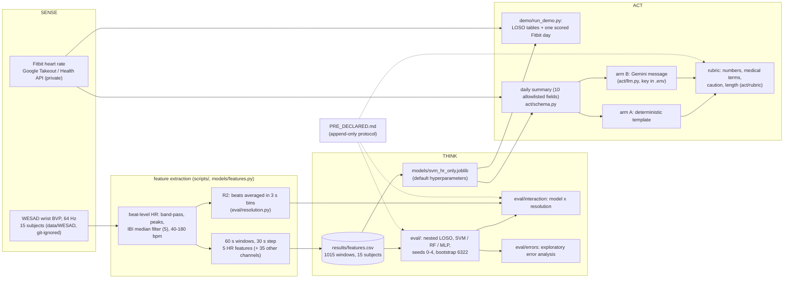

# Architecture: sense - think - act

- **Sense:** WESAD gives labelled lab data (baseline, stress, amusement); a Fitbit day is unlabelled except for
  a few self-labelled sessions held in the separate dashboard project.
- **Think:** only heart-rate features go into the models, so what is evaluated is what a consumer wrist wearable
  can provide. Labels from personal sessions only grade predictions; they never train or tune anything.
- **Act:** the daily summary is turned into a short message by a template or by an LLM; both are scored with the
  same rubric. Only ten allowlisted, de-identified fields leave the machine, and only synthetic inputs have
  been sent to the LLM so far.
