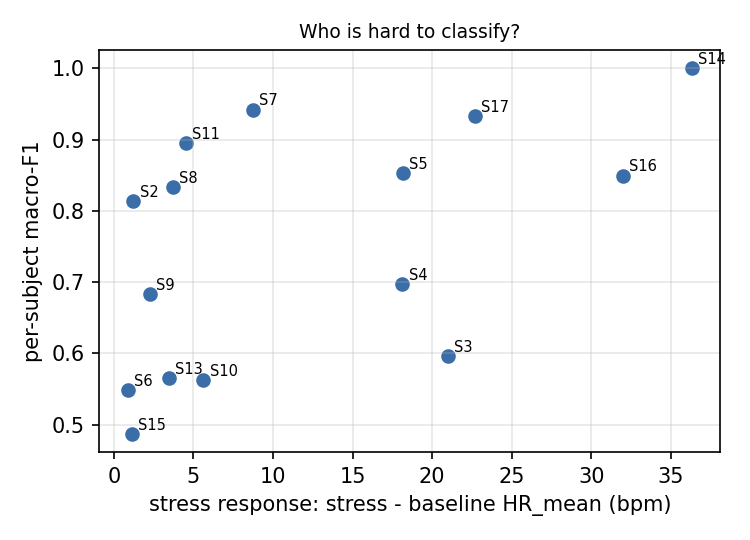
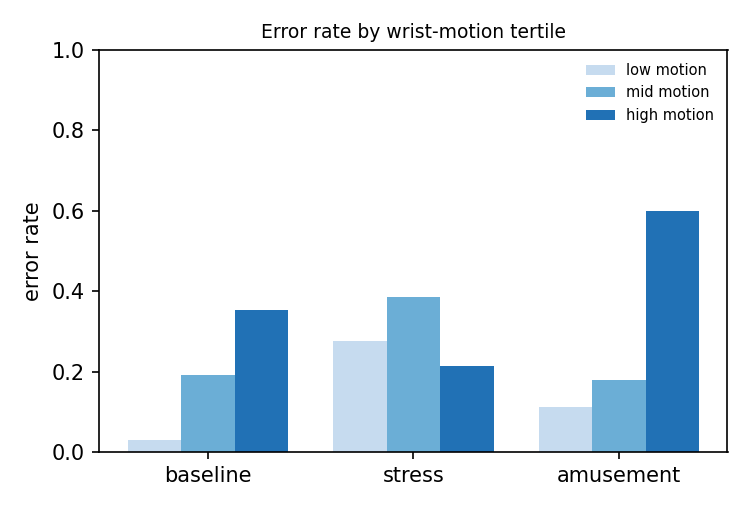
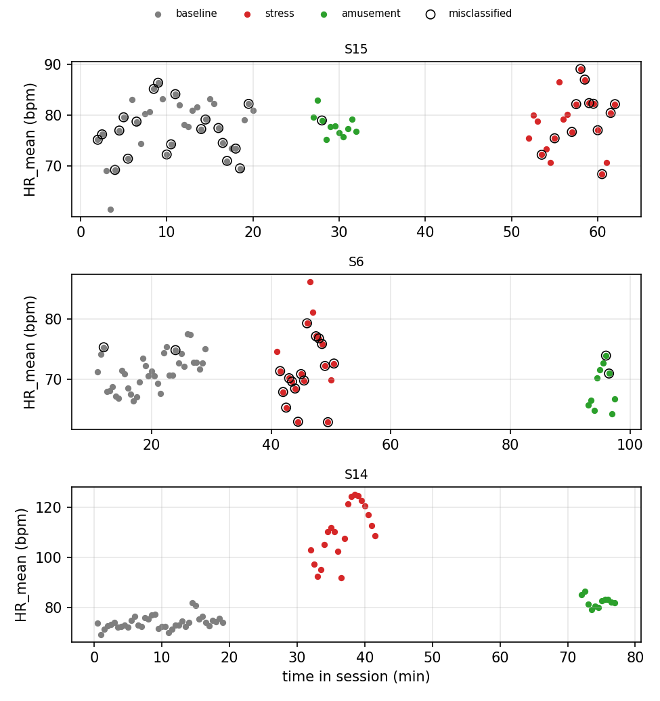

# Error analysis (EXPLORATORY)

Predictions: svm (3-class predictions collapsed to stress vs not (not a binary model)), default hyperparameters, one run, from cv_predictions_hr_only.csv. 1015 windows, 15 subjects. Context (native HR, wrist motion) joined from results/features.csv; the HR-only models never see motion. Not pre-declared; 15 subjects, so correlations are fragile.

Overall window error rate: 0.213.

## 1. Which subjects fail

| subject_id | windows | error_rate | macro_f1 | resting_hr | stress_response | amusement_response | motion_median |
|---|---|---|---|---|---|---|---|
| S15 | 69 | 0.478 | 0.487 | 77.489 | 1.127 | 0.563 | 2.011 |
| S6 | 67 | 0.299 | 0.549 | 71.430 | 0.862 | -2.633 | 1.638 |
| S10 | 69 | 0.435 | 0.563 | 91.548 | 5.626 | -14.146 | 1.930 |
| S13 | 69 | 0.435 | 0.565 | 83.382 | 3.477 | -2.871 | 3.225 |
| S3 | 67 | 0.388 | 0.597 | 61.851 | 20.983 | 2.183 | 1.775 |
| S9 | 66 | 0.212 | 0.683 | 76.702 | 2.278 | 9.338 | 1.431 |
| S4 | 66 | 0.197 | 0.697 | 61.871 | 18.122 | 2.039 | 1.014 |
| S2 | 65 | 0.154 | 0.814 | 73.908 | 1.221 | -1.490 | 1.846 |
| S8 | 68 | 0.132 | 0.833 | 73.069 | 3.725 | -1.447 | 1.626 |
| S16 | 67 | 0.134 | 0.849 | 68.578 | 31.993 | 12.274 | 1.916 |
| S5 | 67 | 0.134 | 0.853 | 66.212 | 18.161 | 3.891 | 1.001 |
| S11 | 70 | 0.086 | 0.895 | 75.179 | 4.544 | -0.991 | 2.908 |
| S17 | 69 | 0.058 | 0.933 | 66.926 | 22.694 | 5.323 | 1.276 |
| S7 | 67 | 0.045 | 0.942 | 72.855 | 8.747 | -14.099 | 0.660 |
| S14 | 69 | 0.000 | 1.000 | 73.888 | 36.322 | 8.445 | 1.726 |

Spearman correlation, stress response vs per-subject macro-F1: rho = +0.66 (p = 0.007, n = 15).

## 2. Which conditions fail

| true \ predicted | non-stress | stress |
|---|---|---|
| amusement | 127 | 29 |
| baseline | 451 | 106 |
| stress | 81 | 221 |

| condition | error_rate | windows |
|---|---|---|
| amusement | 0.186 | 156 |
| baseline | 0.190 | 557 |
| stress | 0.268 | 302 |

## 3. Where inside a condition block

| condition | position | error_rate | windows |
|---|---|---|---|
| amusement | windows 1-2 | 0.233 | 30 |
| amusement | windows 3-5 | 0.111 | 45 |
| amusement | window 6+ | 0.210 | 81 |
| baseline | windows 1-2 | 0.367 | 30 |
| baseline | windows 3-5 | 0.267 | 45 |
| baseline | window 6+ | 0.172 | 482 |
| stress | windows 1-2 | 0.100 | 30 |
| stress | windows 3-5 | 0.178 | 45 |
| stress | window 6+ | 0.308 | 227 |

## 4. Wrist motion (not a model input)

| condition | motion tertile | error_rate | windows |
|---|---|---|---|
| amusement | low | 0.111 | 108 |
| amusement | mid | 0.179 | 28 |
| amusement | high | 0.600 | 20 |
| baseline | low | 0.031 | 162 |
| baseline | mid | 0.192 | 239 |
| baseline | high | 0.353 | 156 |
| stress | low | 0.275 | 69 |
| stress | mid | 0.386 | 70 |
| stress | high | 0.215 | 163 |

Median ACC_mag_std by condition: amusement 0.70, baseline 1.72, stress 2.66.

Non-stress windows called stress (n = 135) had median motion 2.48 vs 1.23 for correct non-stress windows (n = 578); Mann-Whitney p = 3.51e-19 (windows overlap and are not independent, so p is optimistic).

## 5. Absolute vs person-relative heart rate

Error rate by the subject's resting-HR tertile:

| resting HR | amusement | baseline | stress |
|---|---|---|---|
| low | 0.275 | 0.135 | 0.220 |
| mid | 0.096 | 0.032 | 0.313 |
| high | 0.189 | 0.401 | 0.272 |

Diagnostic (uses each subject's own baseline, so NOT a model result): AUROC of HR_mean for stress vs baseline is 0.797 pooled across people and 0.803 after subtracting each subject's resting HR.

## 6. Examples

Examples: for each error type (true condition -> predicted class), the 2 windows closest to that type's median HR_mean (typical, not extreme, errors).

| subject_id | window_start_s | condition | predicted | position | HR_mean | HR_std | ACC_mag_std |
|---|---|---|---|---|---|---|---|
| S5 | 2100.000 | amusement | stress | 8 | 74.570 | 15.330 | 0.410 |
| S13 | 1680.000 | amusement | stress | 1 | 74.790 | 15.270 | 2.820 |
| S13 | 690.000 | baseline | stress | 21 | 79.850 | 10.720 | 1.570 |
| S9 | 750.000 | baseline | stress | 23 | 79.730 | 12.000 | 1.800 |
| S9 | 2280.000 | stress | non-stress | 14 | 76.610 | 6.770 | 0.160 |
| S15 | 3420.000 | stress | non-stress | 11 | 76.740 | 8.770 | 0.920 |

Timelines: the two lowest-F1 subjects and the highest. Circles = misclassified.
