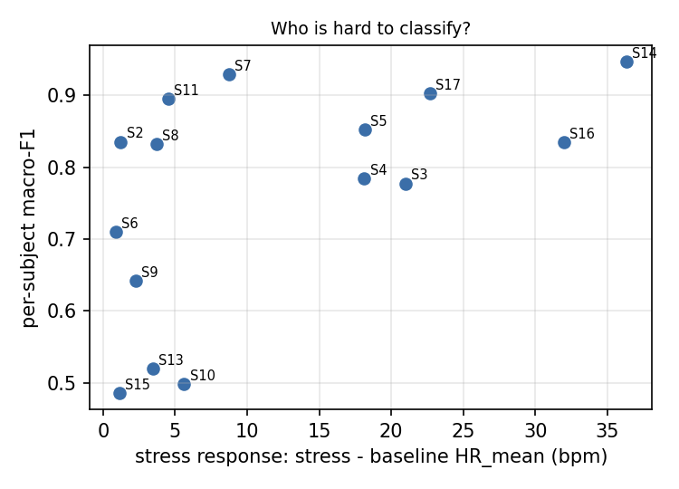
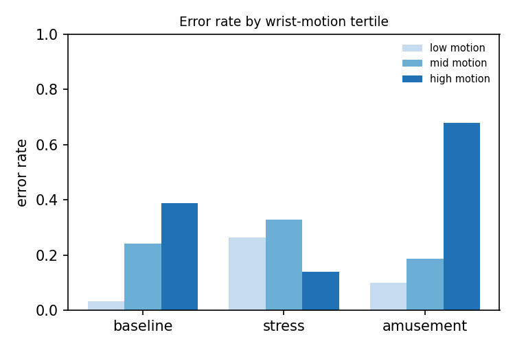
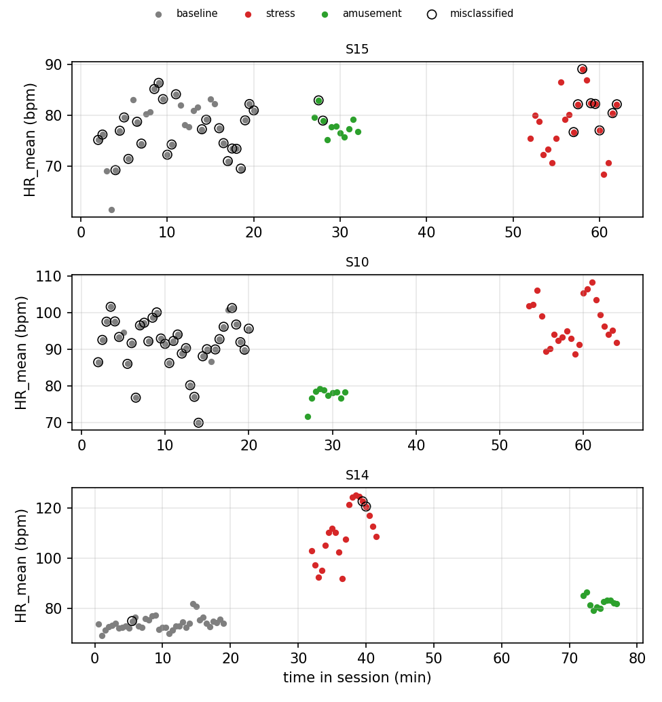

# Error analysis (EXPLORATORY)

Predictions: mlp (binary task), 5 seed(s), from binary_mlp_seed0.csv, binary_mlp_seed1.csv, binary_mlp_seed2.csv, binary_mlp_seed3.csv, binary_mlp_seed4.csv. 1015 windows, 15 subjects. Context (native HR, wrist motion) joined from results/features.csv; the HR-only models never see motion. Not pre-declared; 15 subjects, so correlations are fragile.

Overall window error rate: 0.213.

## 1. Which subjects fail

| subject_id | windows | error_rate | macro_f1 | resting_hr | stress_response | amusement_response | motion_median |
|---|---|---|---|---|---|---|---|
| S15 | 69 | 0.507 | 0.486 | 77.489 | 1.127 | 0.563 | 2.011 |
| S10 | 69 | 0.499 | 0.499 | 91.548 | 5.626 | -14.146 | 1.930 |
| S13 | 69 | 0.455 | 0.520 | 83.382 | 3.477 | -2.871 | 3.225 |
| S9 | 66 | 0.273 | 0.642 | 76.702 | 2.278 | 9.338 | 1.431 |
| S6 | 67 | 0.227 | 0.710 | 71.430 | 0.862 | -2.633 | 1.638 |
| S3 | 67 | 0.242 | 0.777 | 61.851 | 20.983 | 2.183 | 1.775 |
| S4 | 66 | 0.155 | 0.784 | 61.871 | 18.122 | 2.039 | 1.014 |
| S8 | 68 | 0.141 | 0.832 | 73.069 | 3.725 | -1.447 | 1.626 |
| S16 | 67 | 0.134 | 0.834 | 68.578 | 31.993 | 12.274 | 1.916 |
| S2 | 65 | 0.142 | 0.835 | 73.908 | 1.221 | -1.490 | 1.846 |
| S5 | 67 | 0.143 | 0.853 | 66.212 | 18.161 | 3.891 | 1.001 |
| S11 | 70 | 0.097 | 0.895 | 75.179 | 4.544 | -0.991 | 2.908 |
| S17 | 69 | 0.075 | 0.902 | 66.926 | 22.694 | 5.323 | 1.276 |
| S7 | 67 | 0.060 | 0.929 | 72.855 | 8.747 | -14.099 | 0.660 |
| S14 | 69 | 0.041 | 0.946 | 73.888 | 36.322 | 8.445 | 1.726 |

Spearman correlation, stress response vs per-subject macro-F1: rho = +0.59 (p = 0.021, n = 15).

## 2. Which conditions fail

| true \ predicted | non-stress | stress |
|---|---|---|
| amusement | 126 | 30 |
| baseline | 436 | 121 |
| stress | 63 | 239 |

| condition | error_rate | windows |
|---|---|---|
| amusement | 0.188 | 156 |
| baseline | 0.222 | 557 |
| stress | 0.211 | 302 |

## 3. Where inside a condition block

| condition | position | error_rate | windows |
|---|---|---|---|
| amusement | windows 1-2 | 0.307 | 30 |
| amusement | windows 3-5 | 0.169 | 45 |
| amusement | window 6+ | 0.156 | 81 |
| baseline | windows 1-2 | 0.287 | 30 |
| baseline | windows 3-5 | 0.267 | 45 |
| baseline | window 6+ | 0.213 | 482 |
| stress | windows 1-2 | 0.087 | 30 |
| stress | windows 3-5 | 0.093 | 45 |
| stress | window 6+ | 0.251 | 227 |

## 4. Wrist motion (not a model input)

| condition | motion tertile | error_rate | windows |
|---|---|---|---|
| amusement | low | 0.098 | 108 |
| amusement | mid | 0.186 | 28 |
| amusement | high | 0.680 | 20 |
| baseline | low | 0.032 | 162 |
| baseline | mid | 0.242 | 239 |
| baseline | high | 0.387 | 156 |
| stress | low | 0.264 | 69 |
| stress | mid | 0.329 | 70 |
| stress | high | 0.139 | 163 |

Median ACC_mag_std by condition: amusement 0.70, baseline 1.72, stress 2.66.

Non-stress windows called stress (n = 151) had median motion 2.47 vs 1.20 for correct non-stress windows (n = 562); Mann-Whitney p = 1.71e-23 (windows overlap and are not independent, so p is optimistic).

## 5. Absolute vs person-relative heart rate

Error rate by the subject's resting-HR tertile:

| resting HR | amusement | baseline | stress |
|---|---|---|---|
| low | 0.212 | 0.104 | 0.202 |
| mid | 0.115 | 0.077 | 0.208 |
| high | 0.238 | 0.481 | 0.223 |

Diagnostic (uses each subject's own baseline, so NOT a model result): AUROC of HR_mean for stress vs baseline is 0.797 pooled across people and 0.803 after subtracting each subject's resting HR.

## 6. Examples

Examples: largest |score| among wrong windows (most confident errors).

| subject_id | window_start_s | condition | predicted | position | HR_mean | HR_std | ACC_mag_std | abs_score |
|---|---|---|---|---|---|---|---|---|
| S10 | 480.000 | baseline | stress | 13 | 92.200 | 22.940 | 2.810 | 1.000 |
| S15 | 660.000 | baseline | stress | 19 | 84.180 | 16.570 | 1.500 | 0.990 |
| S10 | 420.000 | baseline | stress | 11 | 96.560 | 15.790 | 1.900 | 0.980 |
| S15 | 510.000 | baseline | stress | 14 | 85.220 | 17.520 | 4.950 | 0.970 |
| S10 | 360.000 | baseline | stress | 9 | 91.720 | 15.340 | 1.720 | 0.970 |
| S10 | 450.000 | baseline | stress | 12 | 97.280 | 18.630 | 1.960 | 0.970 |
| S10 | 660.000 | baseline | stress | 19 | 92.310 | 14.790 | 3.090 | 0.970 |
| S15 | 330.000 | baseline | stress | 8 | 71.470 | 20.320 | 2.630 | 0.960 |

Timelines: the two lowest-F1 subjects and the highest. Circles = misclassified.
