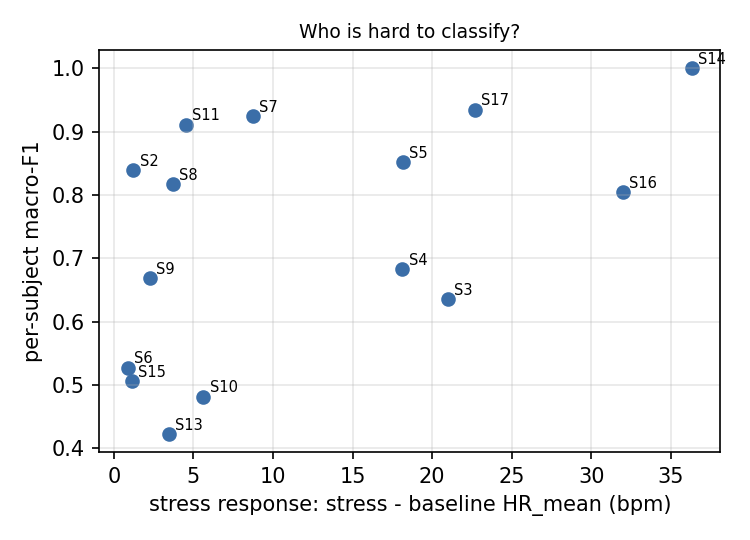
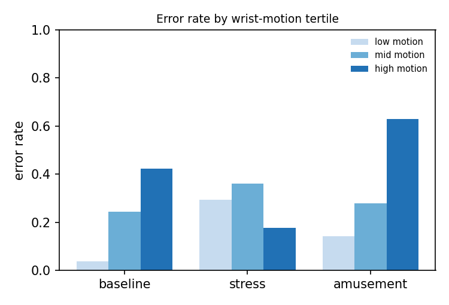
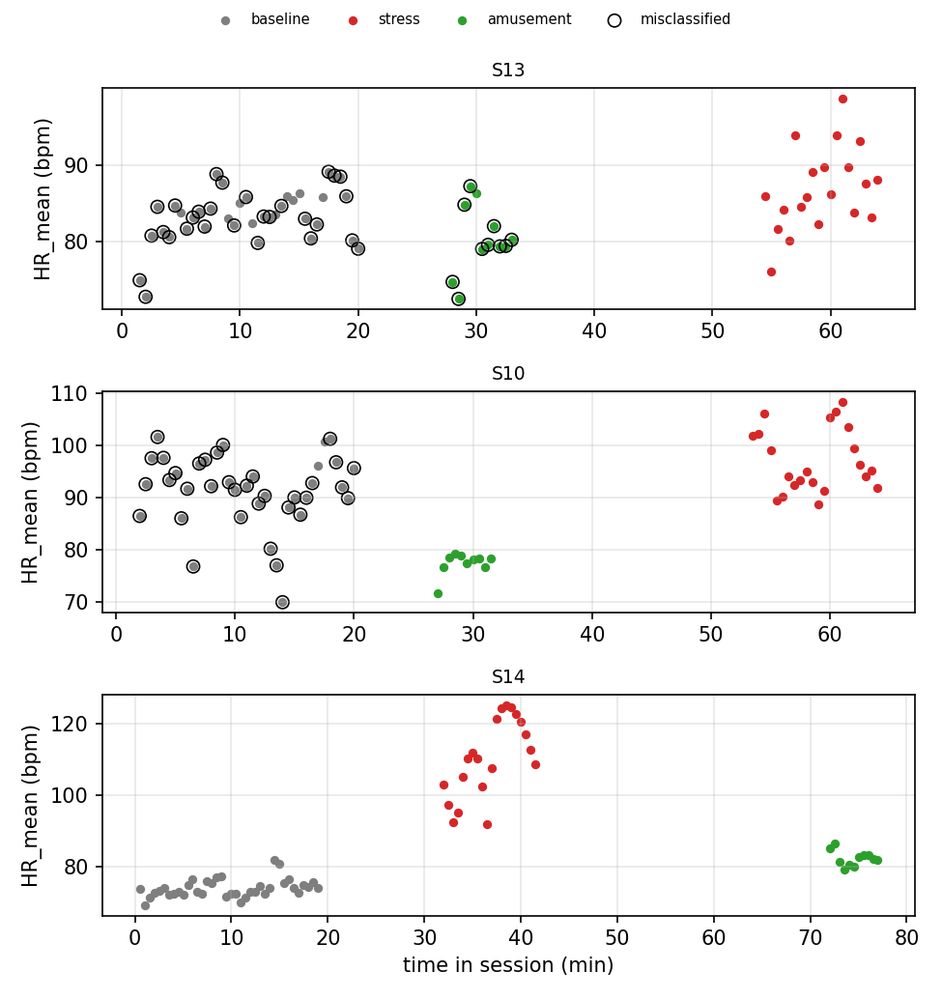

# Error analysis (EXPLORATORY)

Predictions: svm (binary task), 5 seed(s), from binary_svm_seed0.csv, binary_svm_seed1.csv, binary_svm_seed2.csv, binary_svm_seed3.csv, binary_svm_seed4.csv. 1015 windows, 15 subjects. Context (native HR, wrist motion) joined from results/features.csv; the HR-only models never see motion. Not pre-declared; 15 subjects, so correlations are fragile.

Overall window error rate: 0.236.

## 1. Which subjects fail

| subject_id | windows | error_rate | macro_f1 | resting_hr | stress_response | amusement_response | motion_median |
|---|---|---|---|---|---|---|---|
| S13 | 69 | 0.565 | 0.423 | 83.382 | 3.477 | -2.871 | 3.225 |
| S10 | 69 | 0.510 | 0.482 | 91.548 | 5.626 | -14.146 | 1.930 |
| S15 | 69 | 0.501 | 0.507 | 77.489 | 1.127 | 0.563 | 2.011 |
| S6 | 67 | 0.275 | 0.528 | 71.430 | 0.862 | -2.633 | 1.638 |
| S3 | 67 | 0.394 | 0.636 | 61.851 | 20.983 | 2.183 | 1.775 |
| S9 | 66 | 0.245 | 0.669 | 76.702 | 2.278 | 9.338 | 1.431 |
| S4 | 66 | 0.212 | 0.683 | 61.871 | 18.122 | 2.039 | 1.014 |
| S16 | 67 | 0.185 | 0.805 | 68.578 | 31.993 | 12.274 | 1.916 |
| S8 | 68 | 0.150 | 0.817 | 73.069 | 3.725 | -1.447 | 1.626 |
| S2 | 65 | 0.157 | 0.840 | 73.908 | 1.221 | -1.490 | 1.846 |
| S5 | 67 | 0.137 | 0.853 | 66.212 | 18.161 | 3.891 | 1.001 |
| S11 | 70 | 0.071 | 0.911 | 75.179 | 4.544 | -0.991 | 2.908 |
| S7 | 67 | 0.060 | 0.924 | 72.855 | 8.747 | -14.099 | 0.660 |
| S17 | 69 | 0.058 | 0.935 | 66.926 | 22.694 | 5.323 | 1.276 |
| S14 | 69 | 0.017 | 1.000 | 73.888 | 36.322 | 8.445 | 1.726 |

Spearman correlation, stress response vs per-subject macro-F1: rho = +0.54 (p = 0.040, n = 15).

## 2. Which conditions fail

| true \ predicted | non-stress | stress |
|---|---|---|
| amusement | 121 | 35 |
| baseline | 433 | 124 |
| stress | 75 | 227 |

| condition | error_rate | windows |
|---|---|---|
| amusement | 0.228 | 156 |
| baseline | 0.234 | 557 |
| stress | 0.246 | 302 |

## 3. Where inside a condition block

| condition | position | error_rate | windows |
|---|---|---|---|
| amusement | windows 1-2 | 0.300 | 30 |
| amusement | windows 3-5 | 0.191 | 45 |
| amusement | window 6+ | 0.222 | 81 |
| baseline | windows 1-2 | 0.340 | 30 |
| baseline | windows 3-5 | 0.316 | 45 |
| baseline | window 6+ | 0.220 | 482 |
| stress | windows 1-2 | 0.080 | 30 |
| stress | windows 3-5 | 0.133 | 45 |
| stress | window 6+ | 0.290 | 227 |

## 4. Wrist motion (not a model input)

| condition | motion tertile | error_rate | windows |
|---|---|---|---|
| amusement | low | 0.141 | 108 |
| amusement | mid | 0.279 | 28 |
| amusement | high | 0.630 | 20 |
| baseline | low | 0.038 | 162 |
| baseline | mid | 0.244 | 239 |
| baseline | high | 0.422 | 156 |
| stress | low | 0.293 | 69 |
| stress | mid | 0.360 | 70 |
| stress | high | 0.177 | 163 |

Median ACC_mag_std by condition: amusement 0.70, baseline 1.72, stress 2.66.

Non-stress windows called stress (n = 159) had median motion 2.47 vs 1.20 for correct non-stress windows (n = 554); Mann-Whitney p = 9.03e-23 (windows overlap and are not independent, so p is optimistic).

## 5. Absolute vs person-relative heart rate

Error rate by the subject's resting-HR tertile:

| resting HR | amusement | baseline | stress |
|---|---|---|---|
| low | 0.318 | 0.152 | 0.216 |
| mid | 0.131 | 0.052 | 0.279 |
| high | 0.238 | 0.494 | 0.243 |

Diagnostic (uses each subject's own baseline, so NOT a model result): AUROC of HR_mean for stress vs baseline is 0.797 pooled across people and 0.803 after subtracting each subject's resting HR.

## 6. Examples

Examples: largest |score| among wrong windows (most confident errors).

| subject_id | window_start_s | condition | predicted | position | HR_mean | HR_std | ACC_mag_std | abs_score |
|---|---|---|---|---|---|---|---|---|
| S10 | 480.000 | baseline | stress | 13 | 92.200 | 22.940 | 2.810 | 4.370 |
| S10 | 450.000 | baseline | stress | 12 | 97.280 | 18.630 | 1.960 | 3.920 |
| S10 | 510.000 | baseline | stress | 14 | 98.660 | 14.270 | 2.390 | 3.820 |
| S10 | 420.000 | baseline | stress | 11 | 96.560 | 15.790 | 1.900 | 3.420 |
| S10 | 180.000 | baseline | stress | 3 | 97.570 | 11.670 | 1.930 | 3.070 |
| S10 | 330.000 | baseline | stress | 8 | 86.040 | 18.040 | 1.520 | 3.050 |
| S10 | 240.000 | baseline | stress | 5 | 97.640 | 13.590 | 0.380 | 2.960 |
| S10 | 360.000 | baseline | stress | 9 | 91.720 | 15.340 | 1.720 | 2.780 |

Timelines: the two lowest-F1 subjects and the highest. Circles = misclassified.
