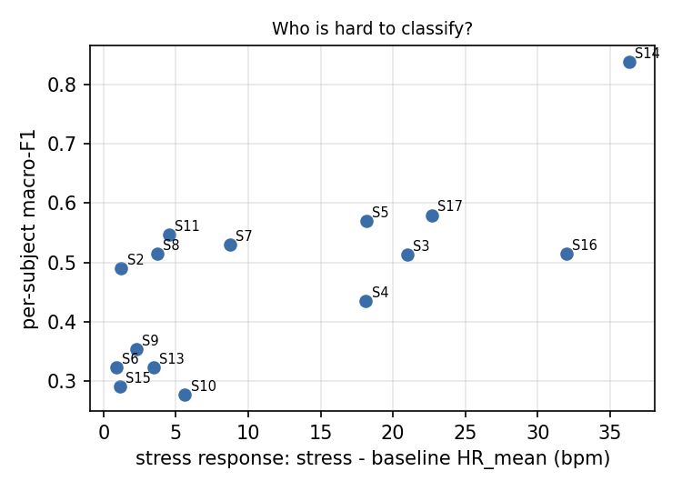
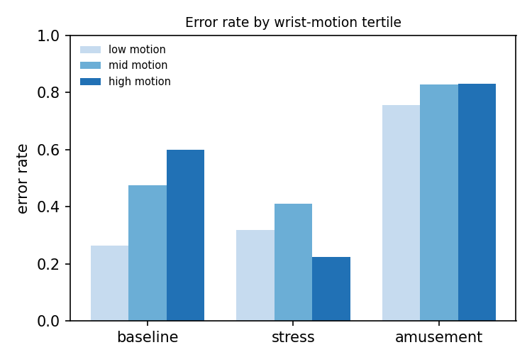
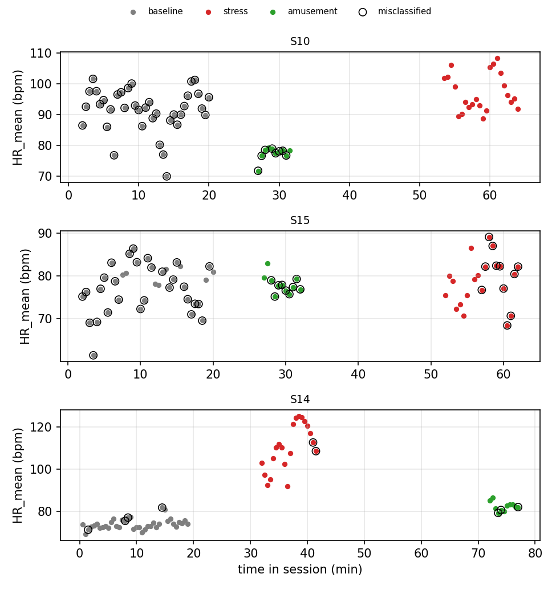

# Error analysis (EXPLORATORY)

Predictions: svm (three task), 5 seed(s), from three_svm_seed0.csv, three_svm_seed1.csv, three_svm_seed2.csv, three_svm_seed3.csv, three_svm_seed4.csv. 1015 windows, 15 subjects. Context (native HR, wrist motion) joined from results/features.csv; the HR-only models never see motion. Not pre-declared; 15 subjects, so correlations are fragile.

Overall window error rate: 0.452.

## 1. Which subjects fail

| subject_id | windows | error_rate | macro_f1 | resting_hr | stress_response | amusement_response | motion_median |
|---|---|---|---|---|---|---|---|
| S10 | 69 | 0.614 | 0.277 | 91.548 | 5.626 | -14.146 | 1.930 |
| S15 | 69 | 0.693 | 0.290 | 77.489 | 1.127 | 0.563 | 2.011 |
| S6 | 67 | 0.478 | 0.322 | 71.430 | 0.862 | -2.633 | 1.638 |
| S13 | 69 | 0.588 | 0.323 | 83.382 | 3.477 | -2.871 | 3.225 |
| S9 | 66 | 0.606 | 0.354 | 76.702 | 2.278 | 9.338 | 1.431 |
| S4 | 66 | 0.485 | 0.435 | 61.871 | 18.122 | 2.039 | 1.014 |
| S2 | 65 | 0.418 | 0.490 | 73.908 | 1.221 | -1.490 | 1.846 |
| S3 | 67 | 0.481 | 0.513 | 61.851 | 20.983 | 2.183 | 1.775 |
| S8 | 68 | 0.429 | 0.514 | 73.069 | 3.725 | -1.447 | 1.626 |
| S16 | 67 | 0.439 | 0.515 | 68.578 | 31.993 | 12.274 | 1.916 |
| S7 | 67 | 0.382 | 0.530 | 72.855 | 8.747 | -14.099 | 0.660 |
| S11 | 70 | 0.337 | 0.547 | 75.179 | 4.544 | -0.991 | 2.908 |
| S5 | 67 | 0.358 | 0.570 | 66.212 | 18.161 | 3.891 | 1.001 |
| S17 | 69 | 0.319 | 0.580 | 66.926 | 22.694 | 5.323 | 1.276 |
| S14 | 69 | 0.157 | 0.838 | 73.888 | 36.322 | 8.445 | 1.726 |

Spearman correlation, stress response vs per-subject macro-F1: rho = +0.71 (p = 0.003, n = 15).

## 2. Which conditions fail

| true \ predicted | amusement | baseline | stress |
|---|---|---|---|
| amusement | 34 | 98 | 24 |
| baseline | 132 | 316 | 109 |
| stress | 29 | 60 | 213 |

| condition | error_rate | windows |
|---|---|---|
| amusement | 0.779 | 156 |
| baseline | 0.449 | 557 |
| stress | 0.289 | 302 |

## 3. Where inside a condition block

| condition | position | error_rate | windows |
|---|---|---|---|
| amusement | windows 1-2 | 0.707 | 30 |
| amusement | windows 3-5 | 0.756 | 45 |
| amusement | window 6+ | 0.820 | 81 |
| baseline | windows 1-2 | 0.453 | 30 |
| baseline | windows 3-5 | 0.462 | 45 |
| baseline | window 6+ | 0.447 | 482 |
| stress | windows 1-2 | 0.113 | 30 |
| stress | windows 3-5 | 0.147 | 45 |
| stress | window 6+ | 0.340 | 227 |

## 4. Wrist motion (not a model input)

| condition | motion tertile | error_rate | windows |
|---|---|---|---|
| amusement | low | 0.757 | 108 |
| amusement | mid | 0.829 | 28 |
| amusement | high | 0.830 | 20 |
| baseline | low | 0.264 | 162 |
| baseline | mid | 0.476 | 239 |
| baseline | high | 0.599 | 156 |
| stress | low | 0.319 | 69 |
| stress | mid | 0.411 | 70 |
| stress | high | 0.223 | 163 |

Median ACC_mag_std by condition: amusement 0.70, baseline 1.72, stress 2.66.

Non-stress windows called stress (n = 133) had median motion 2.48 vs 1.24 for correct non-stress windows (n = 341); Mann-Whitney p = 6.29e-19 (windows overlap and are not independent, so p is optimistic).

## 5. Absolute vs person-relative heart rate

Error rate by the subject's resting-HR tertile:

| resting HR | amusement | baseline | stress |
|---|---|---|---|
| low | 0.776 | 0.405 | 0.250 |
| mid | 0.819 | 0.267 | 0.331 |
| high | 0.743 | 0.672 | 0.285 |

Diagnostic (uses each subject's own baseline, so NOT a model result): AUROC of HR_mean for stress vs baseline is 0.797 pooled across people and 0.803 after subtracting each subject's resting HR.

## 6. Examples

Examples: for each error type (true condition -> predicted class), the 2 windows closest to that type's median HR_mean (typical, not extreme, errors).

| subject_id | window_start_s | condition | predicted | position | HR_mean | HR_std | ACC_mag_std |
|---|---|---|---|---|---|---|---|
| S8 | 1830.000 | amusement | baseline | 6 | 71.710 | 10.030 | 0.500 |
| S6 | 5700.000 | amusement | baseline | 5 | 71.630 | 11.740 | 0.500 |
| S13 | 1680.000 | amusement | stress | 1 | 74.790 | 15.270 | 2.820 |
| S8 | 1860.000 | amusement | stress | 7 | 75.150 | 14.940 | 0.850 |
| S16 | 600.000 | baseline | amusement | 17 | 74.320 | 12.670 | 1.800 |
| S16 | 1140.000 | baseline | amusement | 35 | 74.260 | 16.820 | 4.190 |
| S9 | 750.000 | baseline | stress | 23 | 79.730 | 12.000 | 1.800 |
| S2 | 420.000 | baseline | stress | 4 | 79.760 | 15.490 | 4.060 |
| S3 | 2700.000 | stress | amusement | 16 | 77.480 | 11.860 | 4.850 |
| S9 | 2310.000 | stress | amusement | 15 | 78.030 | 5.930 | 0.190 |
| S4 | 3870.000 | stress | baseline | 9 | 75.230 | 10.010 | 2.330 |
| S4 | 3840.000 | stress | baseline | 8 | 75.290 | 8.800 | 3.100 |

Timelines: the two lowest-F1 subjects and the highest. Circles = misclassified.
